# Visibility-Preserving IBVS via Reference–Increment Coordination

[](https://www.mathworks.com/products/matlab.html)
[](#4-real-robot-experiments)
[](LICENSE)

Code and experimental material for the manuscript
**"Visibility-Preserving Image-Based Visual Servoing via Reference–Increment Coordination Under Random Sampling Intervals"** (under review).

The method, denoted **P-IBVS**, combines two modules around an unchanged IBVS control law:

- **G<sub>s</sub>, FOV-aware virtual reference generation.** An image-plane reference is driven toward the desired features by an attractive field and pushed away from the image border by a repulsive field that is triggered by the *observed* features. The reference is integrated every step and projected into the image, so boundary corrections are introduced and released gradually.
- **G<sub>t</sub>, neurodynamic displacement-increment shaping.** The raw increment Δp<sup>raw</sup><sub>k</sub> = v<sub>c,k</sub>Δt<sub>k</sub> is passed through a shunting model with state memory and soft saturation before execution, which suppresses jitter caused by random sampling intervals.

<p align="center">
  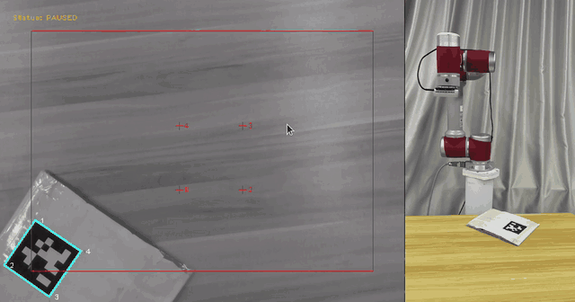
  <br>
  <em>P-IBVS on a JAKA Zu5 manipulator with an eye-in-hand RealSense D435 (real time, 14 s).
  Left: camera view, green curves are the feature trajectories, red box is the safety region.
  Right: robot motion. Full-quality video: <a href="docs/videos/real_robot_pibvs.mp4">real_robot_pibvs.mp4</a>.</em>
</p>

## Contents

- [1. Method overview](#1-method-overview)
- [2. Repository structure](#2-repository-structure)
- [3. Simulation (MATLAB)](#3-simulation-matlab)
- [4. Real-robot experiments](#4-real-robot-experiments)
- [5. Code-to-paper map](#5-code-to-paper-map)
- [6. License and acknowledgements](#6-license-and-acknowledgements)

## 1. Method overview

<p align="center">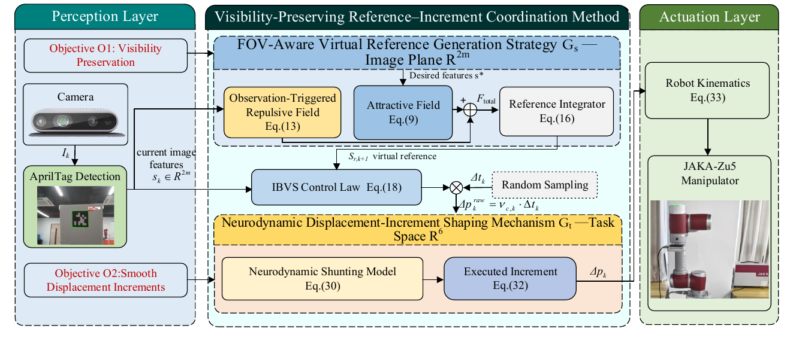</p>

Per control step (Algorithm 1 of the paper):

1. **Spatial layer (G<sub>s</sub>)**: F<sub>att</sub> = k<sub>a</sub>(s\* − s<sub>r,k</sub>); F<sub>rep</sub> from the boundary distances of the observed features inside the warning margin μ; s<sub>r,k+1</sub> = Π<sub>ε</sub>(s<sub>r,k</sub> + (F<sub>att</sub> + F<sub>rep</sub>)Δt<sub>k</sub>).
2. **Control law**: e<sub>k</sub> = s<sub>k</sub> − s<sub>r,k+1</sub>, v<sub>c,k</sub> = −λ(k) L̂<sub>s</sub><sup>+</sup> e<sub>k</sub>, with a sigmoid gain schedule λ(k) from λ<sub>min</sub> to λ<sub>max</sub>.
3. **Temporal layer (G<sub>t</sub>)**: I<sup>±</sup> = max(0, ±KΔp<sup>raw</sup><sub>k</sub>), x<sub>k+1</sub> = x<sub>k</sub> − Ax<sub>k</sub> + (B − x<sub>k</sub>)⊙I<sup>+</sup> − (D + x<sub>k</sub>)⊙I<sup>−</sup>, executed increment Δp<sup>reg</sup><sub>k</sub> = x<sub>k+1</sub>.
4. **Pose update**: T<sub>c,k+1</sub> = T<sub>c,k</sub> exp(Δp̂<sup>reg</sup><sub>k</sub>).

## 2. Repository structure

```plaintext
Visibility-Preserving-IBVS/
├── README.md
├── LICENSE                     # GNU LGPL v3.0
├── COPYING                     # GNU GPL v3.0 (referenced by the LGPL)
├── matlab/
│   ├── C_IBVS_PF_NDRG.m        # Entry script: 4-method comparison, each without/with G_t
│   ├── IBVS.m                  # IBVS class: G_s, G_t, adaptive gain and the baseline front-ends
│   └── VisualServo.m           # Base class (extended from the Machine Vision Toolbox), random sampling interval
└── docs/
    ├── images/                 # Figures reproduced from the manuscript
    └── videos/                 # Real-robot recording (GIF preview and MP4)
```

## 3. Simulation (MATLAB)

### 3.1 Requirements

- MATLAB R2020b or later
- Optimization Toolbox (`quadprog`, used by the MPC-IBVS baseline)
- Fuzzy Logic Toolbox (`mamfis`, used in the `VisualServo` constructor)
- [Machine Vision Toolbox for MATLAB](https://github.com/petercorke/machinevision-toolbox-matlab) and [Spatial Math Toolbox for MATLAB](https://github.com/petercorke/spatialmath-matlab) by P. Corke (`CentralCamera`, `SE3`, `mkgrid`, `tb_optparse`, ...)

The toolboxes are not redistributed here. Either add them to the MATLAB path, or copy their folders `spatial-math/`, `vision/`, `common/` and `Camera/` into `matlab/`; the entry script adds these folders automatically when present. The `IBVS.m` and `VisualServo.m` in this repository must shadow the toolbox versions, which the script checks.

### 3.2 Run

```matlab
cd matlab
C_IBVS_PF_NDRG
```

Figures (`.png`/`.fig`), a metrics table (`unified_four_method_metrics.csv`), a failure summary and all histories (`.mat`) are written to `matlab/compare_outputs/unified_four_method_compare/`.

### 3.3 Setup (Section 4.1)

| Item | Value |
| :-- | :-- |
| Camera | virtual pinhole, eye-in-hand, 1024 × 1024 px, 4 coplanar points |
| Initial / desired features | s<sub>ini</sub> = [210 116 22 116; 908 814 908 1002], s\* = [312 312 712 712; 312 712 712 312] |
| Sampling interval | i.i.d. discrete uniform on {25, …, 35} ms, fixed seed (`random_seed = 42`) |
| Convergence threshold | 0.5 px |
| OG-VFVR-IBVS | adaptive gain λ(0) = 1.5, λ(∞) = 0.4, slope 30; FOV margin 100 px |
| MPC-IBVS | horizon 2, velocity bound 0.25, FOV margin 20 px |
| APF-IBVS | gain 0.4, logarithmic repulsive gain 0.01, influence distance 50 px, increment limit 0.05 m / 0.05 rad |
| P-IBVS | λ<sub>min</sub> = 0.08, λ<sub>max</sub> = 2.55, rate 10.0, centre 0.74; k<sub>a</sub> = 2.0, k<sub>r</sub> = 10000, μ = 50 px |
| G<sub>t</sub> | A = 0.4, B = D = 0.05, K = 8.0 (BK/A = 1) |

### 3.4 Results reported in the manuscript

<details open>
<summary><b>Feature trajectories (Fig. 5) and IBVS without FOV handling (Fig. 4)</b></summary>
<p align="center">
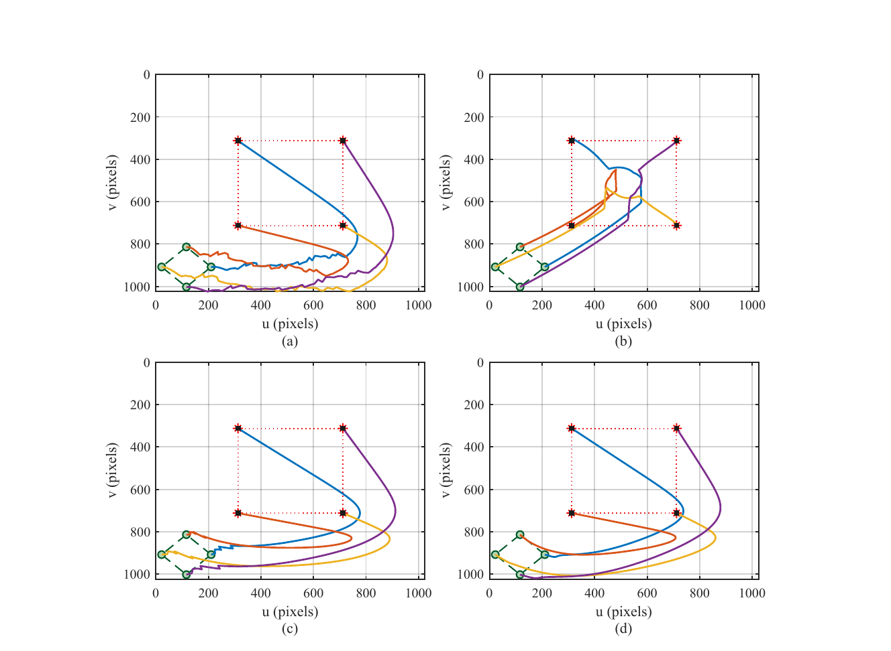<br>
<em>(a) OG-VFVR-IBVS, (b) MPC-IBVS, (c) APF-IBVS, (d) P-IBVS.</em><br><br>
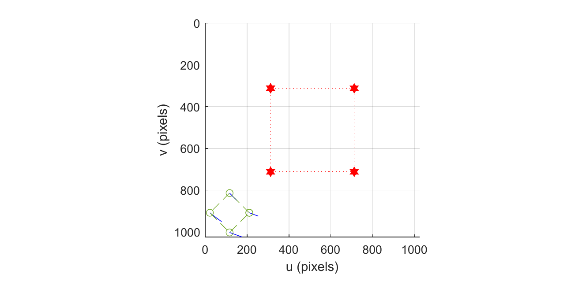<br>
<em>Conventional IBVS drives the features out of the image.</em>
</p>
</details>

<details>
<summary><b>Jacobian condition number (Fig. 6), feature errors (Fig. 7), Cartesian velocity (Fig. 8)</b></summary>
<p align="center">
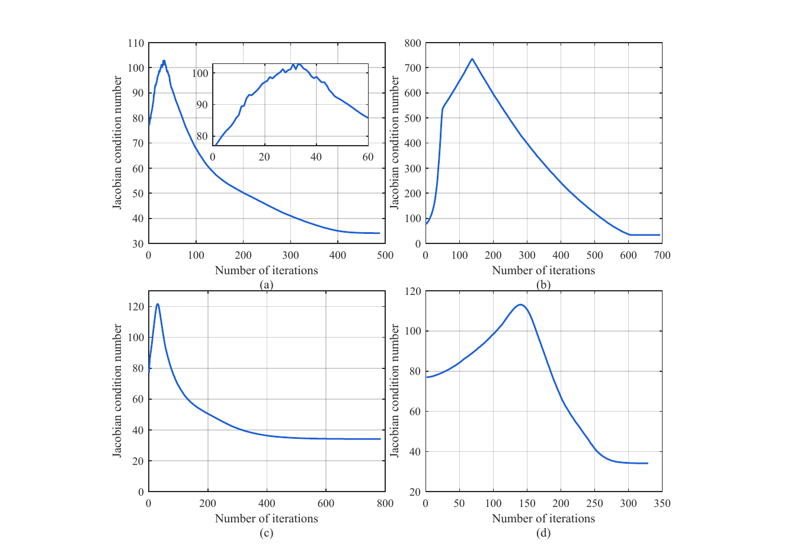<br><br>
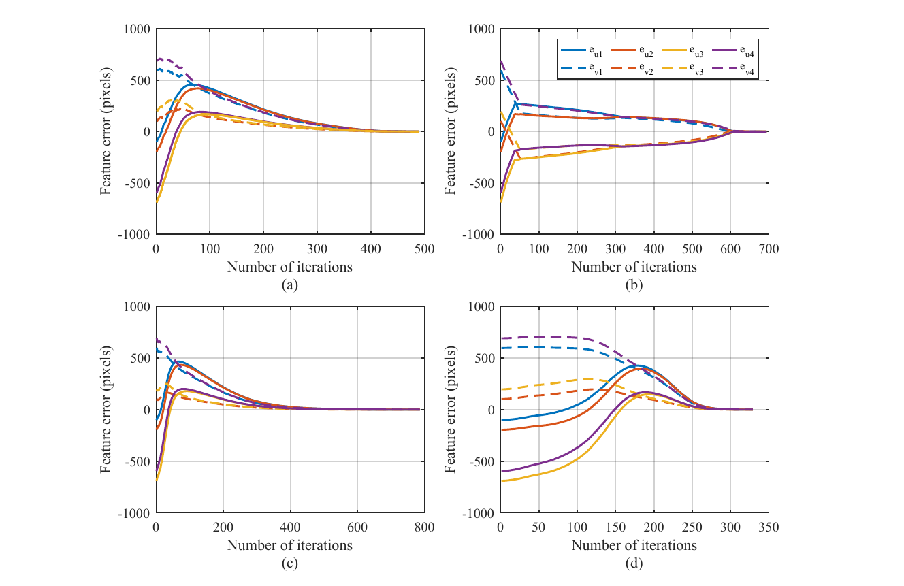<br><br>
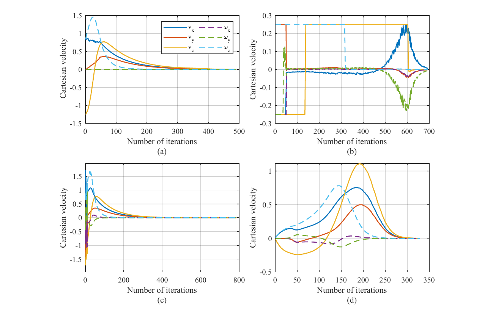
</p>
</details>

<details>
<summary><b>Executed displacement increments without/with G<sub>t</sub> (Fig. 9)</b></summary>
<p align="center">
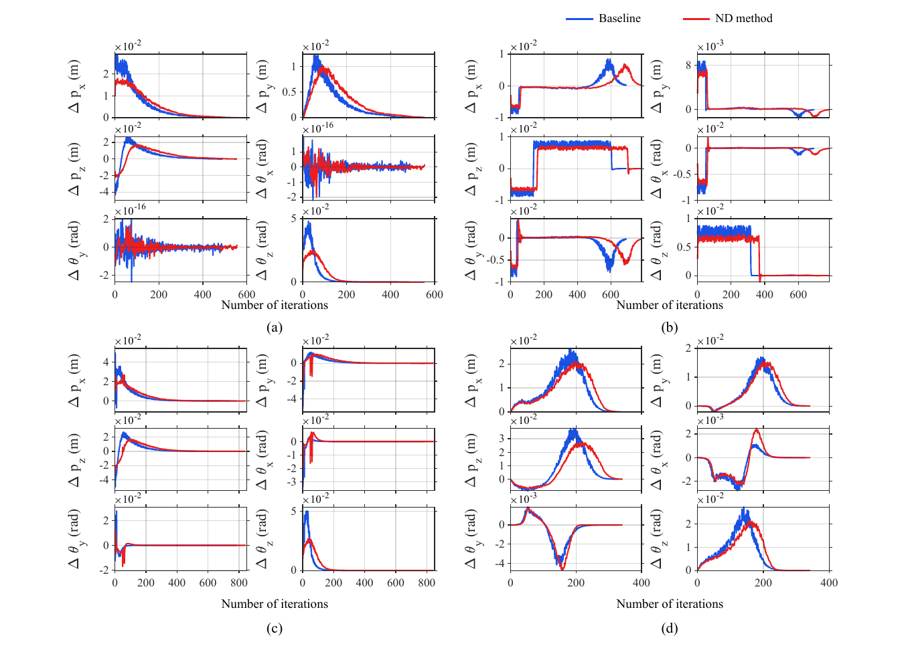<br>
<em>Blue: G<sub>t</sub> disabled; red: G<sub>t</sub> enabled; identical random sampling sequence.</em>
</p>
</details>

| Method | N<sub>conv</sub> | P<sup>tr</sup><sub>II</sub> | P<sup>rot</sup><sub>II</sub> | σ<sub>Δv</sub> | σ<sub>Δ²s</sub> |
| :-- | --: | --: | --: | --: | --: |
| OG-VFVR-IBVS | 489 | 0.696 | 0.283 | 0.016 | 9.755 |
| MPC-IBVS | 694 | 0.250 | 0.250 | 0.022 | 1.188 |
| APF-IBVS | 785 | 1.538 | 0.579 | 0.186 | 4.698 |
| **P-IBVS** | **329** | **0.008** | **0.003** | **0.009** | **1.020** |

*Table 1 of the manuscript.*

## 4. Real-robot experiments

<p align="center">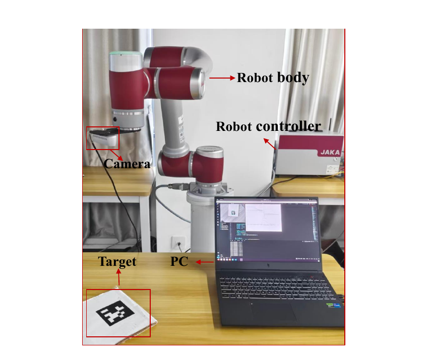</p>

| Item | Value |
| :-- | :-- |
| Manipulator | JAKA Zu5, 6-DoF |
| Camera | Intel RealSense D435, eye-in-hand, 640 × 480 px |
| Target | four AprilTag 36h11 markers on a planar board, m = 4 corner features |
| Host | PC running detection and control, commands sent through the robot command interface |
| Visual feedback interval (recorded run) | mean 35.493 ms, std 4.490 ms, range 27.517–64.383 ms |
| Control computation per step | mean 0.0409 ms, max 0.2177 ms (G<sub>s</sub> + G<sub>t</sub>: 0.0035 ms) |
| AprilTag detection per frame | mean 19.612 ms |

**Conventional IBVS (Fig. 11)** loses the target at the image border within about 2 s, while **P-IBVS (Fig. 12)** keeps the target visible and converges in about 10.5 s.

<p align="center">
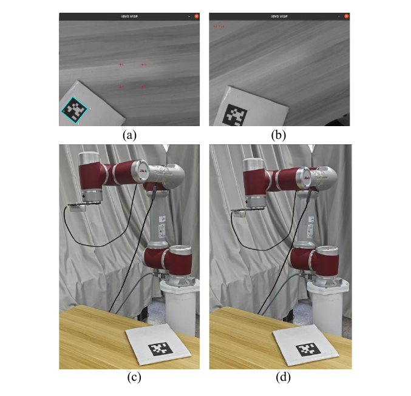
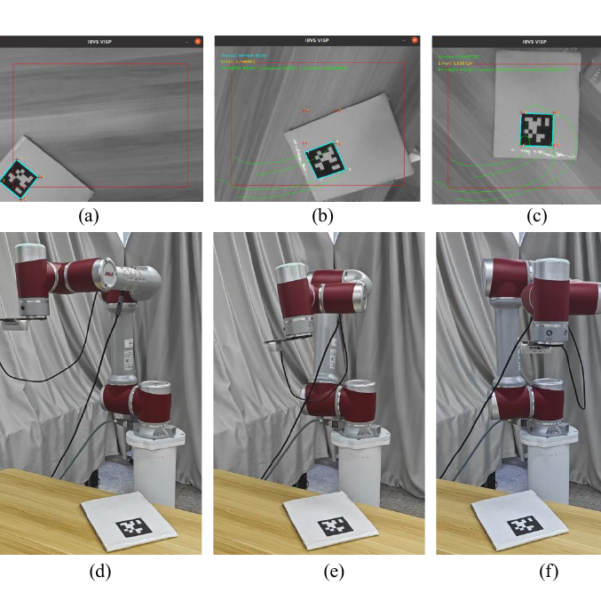
</p>

**Comparison with OG-VFVR-IBVS and MPC-IBVS on the robot (Fig. 13–15).**

<p align="center">
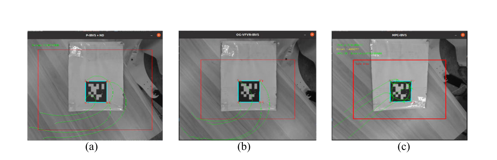<br>
<em>Final camera views: (a) P-IBVS with G<sub>t</sub>, ~10.5 s; (b) OG-VFVR-IBVS, ~11.2 s; (c) MPC-IBVS, ~74.9 s.</em><br><br>
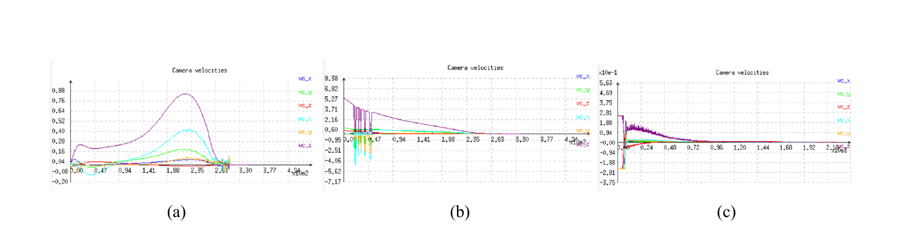<br>
<em>Camera velocity commands without G<sub>t</sub>: (a) P-IBVS, (b) OG-VFVR-IBVS, (c) MPC-IBVS.</em><br><br>
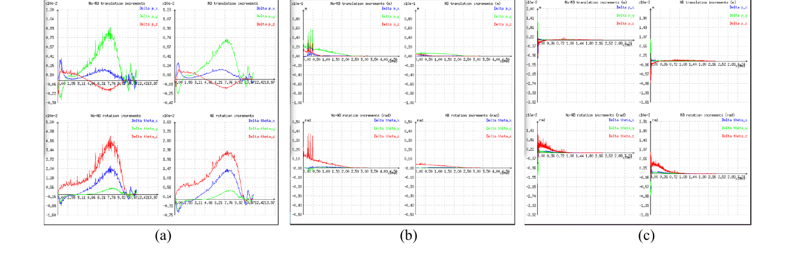<br>
<em>Raw (left) and shaped (right) displacement increments with G<sub>t</sub>.</em>
</p>

| Method | T<sub>conv</sub> (s) | N<sub>conv</sub> | P<sup>tr</sup><sub>II</sub> | P<sup>rot</sup><sub>II</sub> | σ<sub>Δv</sub> | σ<sub>Δ²s</sub> | σ<sub>Δξ</sub> raw → shaped |
| :-- | --: | --: | --: | --: | --: | --: | :-- |
| OG-VFVR-IBVS | 11.205 | 322 | 0.378 | 1.521 | 0.041 | 2.160 | 0.022452 → 0.002775 (−87.6%) |
| MPC-IBVS | 74.982 | 2029 | 0.250 | 0.250 | 0.012 | 1.074 | 0.000959 → 0.000463 (−51.8%) |
| **P-IBVS** | **10.554** | **307** | **0.101** | **0.137** | **0.011** | **0.903** | 0.002268 → 0.000505 (−77.7%) |

*Tables 6 and 7 of the manuscript.*

## 5. Code-to-paper map

| Paper | Location in `matlab/IBVS.m` |
| :-- | :-- |
| Eq. (8)–(16), G<sub>s</sub> virtual reference | `step()`, block `use_pf_frontend` (`pf_attract_gain`, `pf_repulse_gain`, `pf_safety_margin`) |
| Eq. (17)–(18), IBVS law on the virtual reference | `step()`, `e = uv(:) - vs.pf_s_ref(:)`, `v_cmd = -vs.lambda * pinv(J) * e` |
| Eq. (19), sigmoid gain schedule | `step()`, block `lambda_adaptive_enabled` |
| Eq. (20), raw increment with Δt<sub>k</sub> | `step()`, `raw_v_delta = v * dt_step` |
| Eq. (27)–(32), G<sub>t</sub> shunting model | `step()`, block `if vs.nd_enabled` (`A_step`, `B_step`, `D_step`, `K_gain`) |
| Eq. (33), pose update on SE(3) | `step()`, `Td = SE3(trnorm(delta2tr(v_delta)))` |
| OG-VFVR-IBVS baseline [18] | `legacy_fov_virtual_uv()` |
| MPC-IBVS baseline [8] | `mpcqp_controller_pixel()` and helpers |
| APF-IBVS baseline [31] | `partitioned_apf_z_control()`, `partitioned_boundary_repulsion()` |
| Random sampling interval | `C_IBVS_PF_NDRG.m`, `make_dt_sequence()` |

## 6. License and acknowledgements

`IBVS.m` and `VisualServo.m` extend classes of the Machine Vision Toolbox for MATLAB by Peter Corke, which is distributed under the GNU LGPL. This repository is therefore released under the [GNU Lesser General Public License v3.0](LICENSE).

Citation information will be added after the review process.
